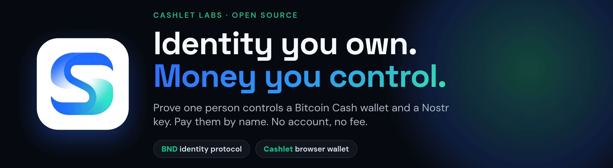
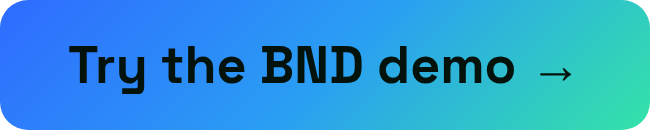
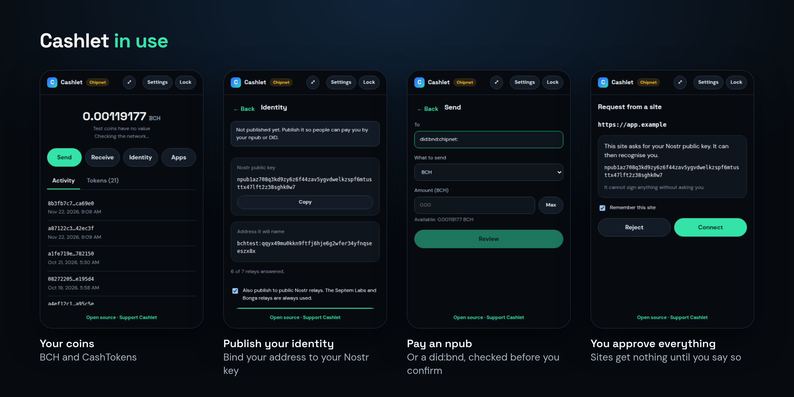

<div align="center">

<picture>
  <source media="(prefers-color-scheme: dark)" srcset="https://raw.githubusercontent.com/cashlet-labs/.github/main/profile/assets/banner-dark.png">
  <source media="(prefers-color-scheme: light)" srcset="https://raw.githubusercontent.com/cashlet-labs/.github/main/profile/assets/banner-light.png">
  
</picture>

<a href="https://bnd.septemlabs.com/demo"></a>&nbsp;
<a href="https://extension.septemlabs.com"></a>&nbsp;
<a href="https://github.com/cashlet-labs/bnd/blob/main/spec/BND-1.md"></a>

</div>

<br>

Open-source tools for Bitcoin Cash identity and payments, built by [Septem Labs](https://septemlabs.com). Link your wallet to your Nostr key with two signatures, and anyone can pay you by `npub` and know the address is yours.



## Two products

<table>
<tr>
<td width="50%" valign="top">

### Cashlet: the wallet

A self-custodial Bitcoin Cash wallet for Chrome. Send and receive BCH and CashTokens, publish your identity, pay any `npub` or `did:bnd`, and approve every request from a site.

No Cashlet server, no account.

**[Install from extension.septemlabs.com →](https://extension.septemlabs.com)**
[Source](https://github.com/cashlet-labs/cashlet-wallet)

</td>
<td width="50%" valign="top">

### BND: the protocol

A BCH key and a Nostr key each sign a statement naming the other. It is published as an ordinary Nostr event that any app can verify offline. Login, key rotation and recovery, and `did:bnd` are built on top.

Code is MIT. The specification is a draft.

**[Try the live demo →](https://bnd.septemlabs.com/demo)**
[Site](https://bnd.septemlabs.com) · [Spec](https://github.com/cashlet-labs/bnd/blob/main/spec/BND-1.md) · [npm](https://www.npmjs.com/package/@cashlet-labs/bnd) · [Source](https://github.com/cashlet-labs/bnd)

</td>
</tr>
</table>

## How a binding works


Relays only store the event. Every app checks the signatures itself, and a stolen Nostr key alone cannot move the identity.

## Add it to your app

```bash
npm install @cashlet-labs/bnd
```

```ts
import { discoverBinding } from "@cashlet-labs/bnd/nostr";

const found = await discoverBinding("npub1…", { relays: ["wss://relay.septemlabs.com"] });
if (found.state.status === "current") pay(found.state.binding.bch.address); // verified
```

The [integration guide](https://github.com/cashlet-labs/bnd/blob/main/docs/integration.md) covers wallets, Nostr clients, login, DIDs and payments. Other languages can implement the spec against the [test vectors](https://github.com/cashlet-labs/bnd/tree/main/spec/vectors).

<details>
<summary><b>More from Cashlet Labs</b></summary>

<br>

- [**cashlet-infra**](https://github.com/cashlet-labs/cashlet-infra): the Nostr relays that enforce BND succession (work in progress).
- [**bitcoin-elixir**](https://github.com/cashlet-labs/bitcoin-elixir): Bitcoin Cash for Elixir: CashAddr, HD keys, an Electrum client, transactions with CashTokens, BCMR metadata and a payment watcher.
- [**cashlet-did-mcp**](https://github.com/cashlet-labs/cashlet-did-mcp): an MCP server for the earlier Cashlet DID library.
- [**cashlet-did**](https://github.com/cashlet-labs/cashlet-did): our earlier identity protocol, replaced by BND. New work should use BND.

</details>

## Support our work

Both projects are free and open. Donations in BCH or CashTokens keep the relays, the DID resolver, the demo and development going.

<table>
<tr>
<td width="50%"></td>
<td width="50%"></td>
</tr>
<tr>
<td><sub><code>bitcoincash:zplfhfkwgpc4ud8k99x97wz689tn0xm5psj0wx2tkt</code></sub></td>
<td><sub><code>bitcoincash:zpwd6edurja89cdq7hppvzq6xxzj5ct58uqf9czcx9</code></sub></td>
</tr>
</table>

## Get involved

Open an issue or a pull request on [bnd](https://github.com/cashlet-labs/bnd). Wallet and Nostr client builders: start with the integration guide above. Contact: hello@septemlabs.com

<sub>Code is MIT. Specification text is CC BY 4.0.</sub>
